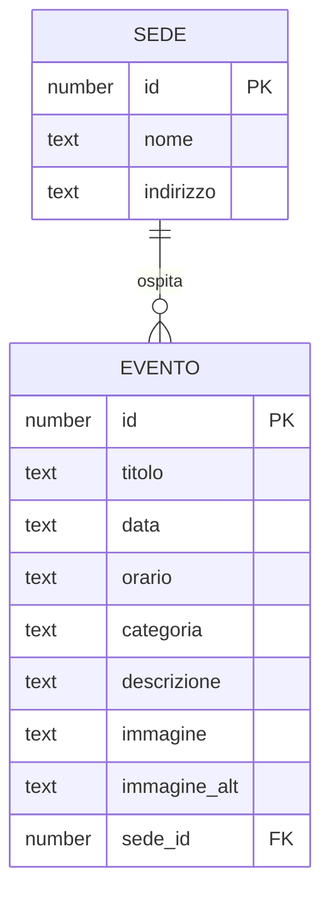

# Schema dati — Segnale

## 1. Entità

Il programma del festival è descritto da due entità distinte:

- **Evento** — un singolo appuntamento del festival (incontro, laboratorio o mostra).
- **Sede** — un luogo in cui si svolgono uno o più eventi.

## 2. Campi, tipi ed esempi

### Evento (`dati/eventi.json`)

| Campo | Tipo | Esempio | Descrizione |
| --- | --- | --- | --- |
| `id` | numero | `1` | Identificativo univoco dell'evento nell'entità Evento. |
| `titolo` | testo | `"Lettere in movimento"` | Nome dell'appuntamento. |
| `data` | testo (data ISO `AAAA-MM-GG`) | `"2026-06-12"` | Giorno dell'evento. |
| `orario` | testo (`HH:MM`) | `"10:00"` | Orario di inizio. |
| `categoria` | testo | `"Incontro"` | Tipo di appuntamento: Incontro, Laboratorio o Mostra. |
| `descrizione` | testo | `"Come cambia un messaggio quando cambiano le lettere? ..."` | Breve presentazione dell'evento. |
| `immagine` | testo (percorso) | `"assets/lettere-in-movimento.svg"` | Percorso dell'immagine della scheda. |
| `immagine_alt` | testo | `"Lettere geometriche disposte su una griglia"` | Testo alternativo dell'immagine. |
| `sede_id` | numero | `1` | Riferimento alla sede che ospita l'evento. |

### Sede (`dati/sedi.json`)

| Campo | Tipo | Esempio | Descrizione |
| --- | --- | --- | --- |
| `id` | numero | `1` | Identificativo univoco della sede nell'entità Sede. |
| `nome` | testo | `"Officina Nord"` | Nome del luogo. |
| `indirizzo` | testo | `"Via delle Officine 12, Torino"` | Indirizzo della sede. |

## 3. Chiavi

- **Chiave primaria di Evento:** `id`, numerico, univoco all'interno dell'entità Evento e stabile nel tempo.
- **Chiave primaria di Sede:** `id`, numerico, univoco all'interno dell'entità Sede e stabile nel tempo.
- **Chiave esterna:** `Evento.sede_id` fa riferimento a `Sede.id`.

## 4. Relazione

Una sede può ospitare zero o più eventi; ogni evento si svolge in una sola sede. Il legame è dato da `Evento.sede_id`, che punta all'`id` della sede corrispondente. Se un `sede_id` non trova una sede corrispondente, l'evento compare comunque con la sede «da definire».

## 5. Quantità

- 6 eventi.
- 3 sedi.

## 6. Chi aggiorna i dati e come

I dati sono memorizzati nei due file JSON nella repository (`dati/eventi.json` e `dati/sedi.json`). Chi lavora al sito modifica direttamente questi file, poi committa e pubblica la repository con GitHub Pages: la pagina legge i file aggiornati alla prossima apertura. Non c'è un database o un pannello di amministrazione.

## 7. Che cosa mostra la pagina

La pagina **Programma** legge i due file con `fetch`, costruisce una scheda per ogni evento e collega ciascun evento alla sua sede tramite `sede_id`. Ogni scheda mostra immagine, titolo, data, orario, categoria, descrizione e nome della sede. La pagina gestisce anche lo stato di caricamento, l'elenco vuoto e l'errore di lettura di un file.

## Schema Evento–Sede (Mermaid)

