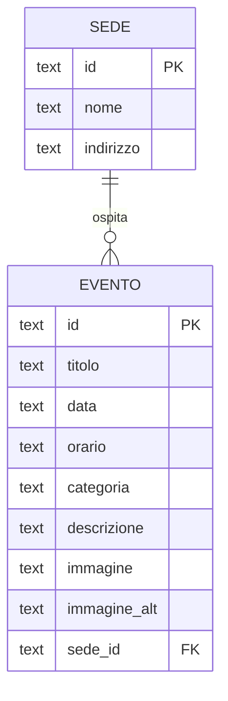

# Schema dati — Segnale

## 1. Entità

Il programma del festival è descritto da due entità distinte:

- **Evento** — un singolo appuntamento del festival (incontro, laboratorio o mostra).
- **Sede** — un luogo in cui si svolgono uno o più eventi.

## 2. Campi, tipi ed esempi

I dati vivono in un foglio Google pubblicato sul web come tre elenchi CSV: `eventi`, `sedi` e `notizie`. I due file JSON in questa cartella restano solo come copia di riferimento; la pagina non li legge più. Ogni valore letto dal CSV è testo, quindi `id` e `sede_id` vengono confrontati dopo aver tolto spazi come stringhe.

### Evento (scheda `eventi` → CSV)

| Campo | Tipo | Esempio | Descrizione |
| --- | --- | --- | --- |
| `id` | testo (numero come stringa) | `"1"` | Identificativo univoco dell'evento nell'entità Evento. |
| `titolo` | testo | `"Lettere in movimento"` | Nome dell'appuntamento. |
| `data` | testo (data ISO `AAAA-MM-GG`) | `"2026-06-12"` | Giorno dell'evento. |
| `orario` | testo (`HH:MM`) | `"10:00"` | Orario di inizio. |
| `categoria` | testo | `"Incontro"` | Tipo di appuntamento: Incontro, Laboratorio o Mostra. |
| `descrizione` | testo | `"Come cambia un messaggio quando cambiano le lettere? ..."` | Breve presentazione dell'evento. |
| `immagine` | testo (percorso) | `"assets/lettere-in-movimento.svg"` | Percorso dell'immagine della scheda. |
| `immagine_alt` | testo | `"Lettere geometriche disposte su una griglia"` | Testo alternativo dell'immagine. |
| `sede_id` | testo (numero come stringa) | `"1"` | Riferimento alla sede che ospita l'evento. |

### Sede (scheda `sedi` → CSV)

| Campo | Tipo | Esempio | Descrizione |
| --- | --- | --- | --- |
| `id` | testo (numero come stringa) | `"1"` | Identificativo univoco della sede nell'entità Sede. |
| `nome` | testo | `"Officina Nord"` | Nome del luogo. |
| `indirizzo` | testo | `"Via delle Officine 12, Torino"` | Indirizzo della sede. |

### Notizia (scheda `notizie` → CSV, facoltativa nella Home)

| Campo | Tipo | Esempio | Descrizione |
| --- | --- | --- | --- |
| `titolo` | testo | `"..."` | Titolo dell'articolo letto dal feed ANSA Piemonte. |
| `link` | testo (URL) | `"https://..."` | Collegamento alla notizia originale. |
| `data` | testo (data) | `"2026-11-25 10:30"` | Data di pubblicazione dal feed RSS. |

## 3. Chiavi

- **Chiave primaria di Evento:** `id`, univoco all'interno dell'entità Evento e stabile nel tempo. Nel CSV è testo, ma identifica lo stesso evento del numero corrispondente.
- **Chiave primaria di Sede:** `id`, univoco all'interno dell'entità Sede e stabile nel tempo. Nel CSV è testo, ma identifica la stessa sede del numero corrispondente.
- **Chiave esterna:** `Evento.sede_id` fa riferimento a `Sede.id`.

## 4. Relazione

Una sede può ospitare zero o più eventi; ogni evento si svolge in una sola sede. Il legame è dato da `Evento.sede_id`, che punta all'`id` della sede corrispondente. Se un `sede_id` non trova una sede corrispondente, l'evento compare comunque con la sede «da definire».

## 5. Quantità

- 6 eventi.
- 3 sedi.

## 6. Chi aggiorna i dati e come

I dati sono memorizzati in un foglio Google, che viene pubblicato sul web in formato CSV (File > Condividi > Pubblica sul web). Chi aggiorna il programma modifica direttamente le celle del foglio: dopo la modifica la pagina legge il CSV aggiornato alla prossima apertura, senza dover committare o ripubblicare il sito. I link CSV sono scritti nei file `programma.js` e `notizie.js` della repository. I JSON restano in `dati/` solo come copia di riferimento e non sono letti dalle pagine.

## 7. Che cosa mostra la pagina

La pagina **Programma** legge i due CSV pubblicati con Papa Parse, costruisce una scheda per ogni evento e collega ciascun evento alla sua sede tramite `sede_id`. Ogni scheda mostra immagine, titolo, data, orario, categoria, descrizione e nome della sede. La Home aggiunge un riquadro con le prime cinque notizie ANSA Piemonte lette da un terzo CSV. Le pagine gestiscono lo stato di caricamento, l'elenco vuoto e l'errore di lettura; un errore del riquadro notizie non blocca il resto della Home.

## Schema Evento–Sede (Mermaid)

